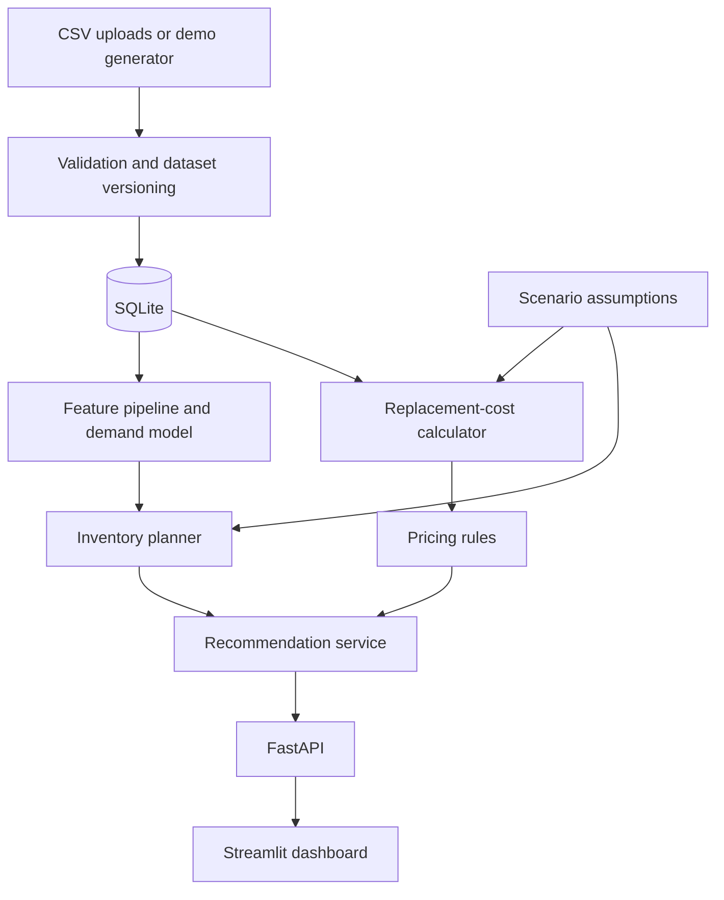

# RestockIQ: Application Architecture and Codex Build Reference

Version: 1.0 | Date: 2026-10-16 | Status: implementation specification, not an implemented application

Working name: RestockIQ. The name can be changed without changing the architecture.

## 1. Product goal

Build a hackathon MVP for a fictional Pakistani electronics-accessories retailer. Help the owner understand whether today's sales can fund tomorrow's replenishment, forecast inventory risk, and evaluate pricing and purchasing decisions.

The product combines:

1. A trained Random Forest demand forecasting model.
2. A transparent replacement-cost calculator.
3. Pricing and replenishment rules.
4. A scenario simulator that changes exchange rates, supplier prices, and delivery times.
5. A dashboard that explains recommendations and their assumptions.

Primary question: **What should I reorder, when, and at what selling price can I support my target replacement-cost margin?**

This is a single-business, single-location, daily-resolution MVP. Default currency is PKR and business timezone is Asia/Karachi. Its reproducible demo uses synthetic data, visibly labeled throughout. It must work without internet access or paid APIs.

## 2. Scope and boundaries

### Required MVP

- Generate a seeded, coherent synthetic dataset for 20 SKUs over 365 days.
- Import and validate equivalent CSV datasets.
- Train and evaluate Random Forest against a seven-day average baseline.
- Produce daily forecasts for horizons from 1 to 30 days.
- Calculate current and scenario replacement costs.
- Recommend prices, stockout estimates, reorder alerts, and order quantities.
- Run isolated scenarios without modifying the base dataset.
- Inspect a product's sales, forecasts, costs, and recommendation explanations.
- Show model evaluation and data limitations to judges.
- Record recommendations as acknowledged or rejected locally.
- Export a recommendation report as CSV.

### Explicitly excluded from MVP

- Live supplier/POS/Shopify/WooCommerce integrations.
- Automatic price publication or supplier purchase orders.
- Future FX prediction or ML-based supplier-cost prediction.
- Learned price elasticity or revenue optimization.
- Manufacturing bills of materials, multiple warehouses, accounting or tax filing.
- Authentication, multi-tenancy, public production hosting, payment processing.
- LLM chat, vector databases, streaming infrastructure, or deep learning.

Acknowledging a recommendation is an audit action only. It must not imply that a price was published or a purchase order was sent. Deployment beyond a local demonstration requires a separate authentication and security design.

## 3. Chosen implementation stack

These are project design choices, not requirements to use the latest release. Resolve compatible versions during implementation and lock the environment.

| Layer | Choice | Purpose |
| --- | --- | --- |
| Language | Python | One language for application and ML |
| Presentation | Streamlit | Fast interactive dashboard and scenario controls |
| Service interface | FastAPI with Pydantic schemas | Typed API for reusable engine operations |
| Data processing | pandas and NumPy | Validation, daily features, simulation |
| ML | scikit-learn | RandomForestRegressor, preprocessing, metrics |
| Storage | SQLite with SQLAlchemy | Local persistent datasets, runs, recommendations |
| Charts | Plotly | Interactive histories, forecasts, comparisons |
| Model files | joblib plus JSON metadata | Locally generated model pipeline and provenance |
| Tests | pytest | Leakage, calculations, validation, API behavior |

Run Streamlit and FastAPI as separate local processes. UI requests go through the API; UI must not duplicate formulas or access database tables directly. Domain services can also be called by CLI scripts for reproducible training and demonstrations. No Redis, Celery, Docker, or cloud account is required.

## 4. Component architecture



Demand and replacement-cost calculations operate independently and meet in the recommendation service. No artificial dependency requires demand predictions before costs can be calculated.

### Service responsibilities

| Module | Responsibility |
| --- | --- |
| ingestion | Parse CSVs, validate schema and relationships, commit datasets atomically |
| synthetic | Generate deterministic business histories and separate evaluation truth |
| features | Build historical features using information available at forecast origin |
| training | Fit preprocessing and candidate models, evaluate, save model artifacts |
| forecasting | Produce horizon forecasts and baseline fallback |
| costs | Select valid quotes/rates and compute landed replacement cost |
| pricing | Calculate target price and apply explicit business constraints |
| inventory | Project stock, identify shortages, calculate reorder and quantities |
| scenarios | Apply input overrides to a read-only base snapshot |
| recommendations | Merge outputs, warnings, explanations, and provenance |
| jobs | Track queued/running/completed/failed operations |
| exports | Produce data and recommendation downloads |

## 5. Time, units, and data conventions

- Dates use ISO YYYY-MM-DD; timestamps use timezone-aware ISO 8601.
- The demo clock is explicit. A seeded dataset ends on a configured date; forecasts start the next day. Never silently use the computer's date for historical demo data.
- Forecast origin is end of business day. Inputs are limited to information known by that instant.
- Quantities are nonnegative whole units. Predictions may be fractional; purchase quantities round up.
- Money uses Decimal in financial calculations, two-decimal output, and integer minor-unit database columns where practical. Do not depend on binary floating-point for price rounding.
- FX rates mean PKR per one unit of quote currency. PKR uses a rate of 1.
- Selling prices and costs use the same tax basis. MVP uses tax-exclusive selling prices and explicitly entered nonrecoverable landed charges; it does not infer jurisdictional taxes.
- Target margin is a fraction in [0, 0.80]. A 20% margin is 0.20, not 20.
- Every dataset includes provenance: synthetic or uploaded. Every signal includes source, observed_at, and freshness status.

## 6. Input contracts

CSV import is a batch containing the following six tables. The generator produces the same contracts. Optional fields have documented defaults; unknown product references or contradictory records fail validation.

### products.csv

One row per SKU.

| Field | Type | Rule |
| --- | --- | --- |
| sku | string | Unique, required |
| name, category | string | Required |
| supplier_id | string | One primary supplier per SKU in MVP |
| current_price_pkr | decimal | Positive |
| historical_unit_cost_pkr | decimal | Nonnegative; informational accounting comparison |
| target_margin | decimal | Default 0.20 |
| default_lead_days | integer | 1–30 |
| safety_days | integer | Default 2, nonnegative |
| review_days | integer | Default 7, positive |
| moq | integer | Default 1, positive |
| pack_size | integer | Default 1, positive |

### daily_sales.csv

One row per SKU per business day; unique key (sku, date).

Fields: date, sku, units_sold, selling_price_pkr, promo_active, fully_in_stock, store_open.

- fully_in_stock means the product remained available throughout trading hours, not merely that closing stock was positive.
- Missing records are not automatically zero sales. Require a complete calendar or return an actionable validation error.
- MVP sales are nonnegative fulfilled units. Returns are excluded from the demo; real imports must normalize returns separately rather than treating them as negative demand.
- Promotions are observed historical inputs; future promotional schedules are outside MVP and forecast as inactive.

### inventory.csv

Fields: sku, snapshot_date, on_hand_units, reserved_units.

- One snapshot date for the whole dataset, matching the forecast origin.
- reserved_units defaults to zero and cannot exceed on_hand_units.
- Reserved units represent prior commitments not included in future demand forecasts.
- They are deducted once when calculating available stock.

### supplier_quotes.csv

Fields: quote_id, sku, supplier_id, observed_at, currency, unit_price, freight_unit_pkr, other_unit_pkr, valid_until (optional).

- Supported MVP currencies: PKR and USD.
- Charges are nonnegative, explicitly per unit, and assumed fixed in PKR under an FX-only scenario.
- Quotes represent supplier acquisition price, not an unexplained mixture of purchase and landed cost.
- Use latest eligible quote observed by the origin; show a warning for an expired quote. If missing, block pricing rather than substituting historical cost silently.

### purchase_orders.csv

Fields: po_id, sku, supplier_id, ordered_at, ordered_units, expected_arrival_date, actual_arrival_date (nullable), unit_price, currency, status.

- Status: open, received, cancelled. No partial receipts in MVP.
- Open orders contribute scheduled arrivals; received/cancelled orders do not contribute future supply.
- Received orders must have actual_arrival_date. Arrival cannot precede ordering.
- Dates and status must describe knowledge at the selected dataset origin.
- Historical backtests must reconstruct what was known then; never reveal eventual arrival dates before they occurred.

### fx_rates.csv

Fields: date, currency, pkr_per_unit, source.

- One row per date/currency. Positive rates only.
- Lookup uses latest rate on or before origin; never backward-fill with a future rate.
- Default freshness warning: rate older than 3 calendar days; configurable. Missing rate blocks the affected cost calculation.
- Synthetic rates use source=synthetic, not the name of a real provider.

### Dataset manifest

Store dataset_id, schema_version, seed (if synthetic), provenance, start_date, end_date, timezone, row_counts, created_at, file hashes, and validation summary.

## 7. Synthetic data design

Default seed: 42. Default business: 20 electronic-accessory SKUs across chargers, cables, headphones, power banks, and stands. Generate 365 daily observations per SKU, approximately 7,300 sales rows.

Generation must be internally consistent:

1. Assign SKU-specific base demand and category patterns.
2. Generate a positive, noisy FX series with occasional shocks; do not describe it as historical Pakistan FX data.
3. Generate supplier quotes periodically, with product-specific changes and delayed FX effects for selected local-currency suppliers. Direct USD quotes convert through the cost calculator.
4. Generate latent demand using weekday effects, modest trend, promotion effects, occasional fictional demand events, and overdispersed count noise.
5. Simulate stock movements day by day: receipts arrive before trading; fulfilled sales cannot exceed available inventory.
6. Generate purchase orders with variable delivery delays and a simple stocking policy.
7. Record actual sales and availability flags. End-of-day inventory reconciles with receipts and fulfilled sales.
8. Save latent demand and simulated future truth in a separate evaluation-only location. These columns must never enter normal feature construction or model training.

Use variation across SKUs and time; avoid making every supplier price a perfect function of FX or every day's demand a deterministic formula. Include a few difficult products and held-out shifts. Synthetic performance validates mechanics under assumptions, not commercial effectiveness.

The demo generator must regenerate identical data for the same configuration and seed. A second evaluation seed may be used to check that the workflow does not depend on one conveniently easy sample.

## 8. Demand ML specification

### Model and target

Use one pooled RandomForestRegressor across all SKUs. Encode sku and category using one-hot encoding with unknown categories handled safely. Fit preprocessing only on training data.

The model estimates unconstrained unit demand using fully available, open-store training days as observable demand examples. It cannot recover true demand on stockout days from sales alone. Exclude censored target days; do not label them zero-demand examples.

### Features

- sku and category.
- Target-date day of week and month.
- Sales/demand-proxy lags at 1, 7, and 14 days.
- Trailing 7-day and 28-day mean demand proxy.
- Trailing 7-day standard deviation.
- Trailing availability fraction.
- Historical promotion indicator; future assumed inactive.

For lag construction on censored historical days, use an explicitly labeled proxy: trailing mean of prior uncensored open-store observations only. Forward-compute this proxy without future information. Retain missingness/availability flags. Drop rows without enough prior history; use baseline fallback for sparse SKUs.

Do not use price as an MVP forecasting feature. This intentionally avoids implying that proposed price changes have a validated causal effect on demand. Scenario prices do not alter demand predictions.

### Initial configuration

Start with 200 trees, max_depth=12, min_samples_leaf=3, random_state=42, n_jobs=-1. These are initial choices, not proven optimal settings. Tune a small number of settings on validation dates only if useful.

Require at least 60 historical days and 30 uncensored target observations per SKU for model-based inference; otherwise use a clearly labeled baseline if enough valid history exists. With no usable observations, return insufficient_history rather than inventing a prediction.

### Multi-day forecasts

Use recursive forecasts for 1–30 days:

1. Construct features from history available at origin.
2. Predict the next day's demand.
3. Append the prediction to an isolated working demand history.
4. Recompute lag/rolling features for the following day.
5. Repeat through the requested horizon.

Use future calendar dates but no actual future sales, stock, promotions, or latent demand. Do not cap demand by available stock; inventory projection handles fulfillment separately. Clip predictions at zero and retain fractional expected demand.

### Baseline and evaluation

Baseline: constant future demand equal to the last seven available uncensored open-store observations, using up to the previous 28 calendar days; show when fewer observations are available.

Default chronological split: first 70% of dates training, next 15% validation, final 15% test, shared across all SKUs. Use rolling origins with enough remaining dates for the complete selected horizon. Within a multi-day forecast, never refresh features using actual intermediate future sales.

Report:

- MAE in units per SKU-day, overall and by SKU.
- WAPE = sum absolute errors / sum actual units, undefined if denominator is zero.
- 7-day and 30-day cumulative demand error where enough test dates exist.
- Baseline and Random Forest side by side, with sample counts and exclusions.
- Percentage of observations excluded for censoring or closures.

Primary observable-sales evaluation uses uncensored open-store targets. Synthetic latent-demand evaluation is optional and separately labeled simulation-only; evaluation truth is never an input.

Choose model versus baseline using validation performance, then report both on untouched test dates. Never choose using test results or force the RF to win. Refit the selected method on all eligible history for final demo inference and distinguish that production artifact from the held-out evaluation artifact.

Store model_id, dataset_id, feature version, train cutoff, parameters, selected method, metrics, seed, creation time, and dependency versions. Only load locally generated trusted joblib artifacts.

### Uncertainty

MVP forecasts are point estimates. Safety stock is a configurable heuristic, not a calibrated confidence interval. Do not call tree-to-tree spread a validated prediction interval. UI wording: estimated stockout date, not exact stockout date.

## 9. Replacement-cost and pricing engine

### Current replacement cost

For a quote in currency c:

C = quote.unit_price × FX(c) + freight_unit_pkr + other_unit_pkr

PKR uses FX=1. Historical purchase cost is displayed separately and never silently treated as the current quote.

### Scenario replacement cost

Inputs: fx_change_pct, supplier_price_change_pct, additional_freight_pkr, extra_lead_days, and optional target_margin override. Percentages use human-facing values such as 10 for 10%, converted once internally.

Scenario quote = current quote × (1 + supplier_price_change_pct / 100)

Scenario FX = current FX × (1 + fx_change_pct / 100), for USD quotes only.

Scenario C = scenario quote × scenario FX + current freight + additional freight + other charges.

Do not FX-adjust local PKR quotes automatically. A separate supplier-price assumption can represent local supplier pass-through. Explain potential double counting if users intentionally increase both a foreign supplier price and FX.

A scenario is a what-if assumption, not a future FX or supplier-price forecast. In the base case, current costs are carried forward unchanged for planning, explicitly labeled as an assumption.

### Price and margin

Unconstrained target price = C / (1 − target_margin).

Suggested price = target price rounded upward to a configurable price step, default PKR 5.

Replacement-cost margin = (selling_price − C) / selling_price.

Replacement funding shortfall per unit = max(0, C − selling_price).

Optional maximum price-change cap defaults to off. If enabled and it prevents achieving target margin, display the capped suggestion, achievable margin, and target_margin_unmet warning. Never claim the constraint-preserved price achieves the target.

Keep accounting gross difference (price minus historical cost), replacement-cost margin, and funding shortfall distinct. The calculation is not net profit and excludes costs not explicitly modeled.

## 10. Inventory and replenishment engine

Let available stock = on_hand − reserved. Let inventory position = available stock + all open ordered units. Reserved units are deducted only once.

Use observed completed-order lead times available at origin when at least five exist for the supplier: rounded-up median, with sample count displayed. Otherwise use default_lead_days. Add scenario extra_lead_days to prospective order lead time.

Scenario delay also shifts each open order's expected arrival by extra_lead_days; make this assumption visible. An already overdue order is flagged and excluded from guaranteed projected receipts until an updated arrival date is supplied. Display it separately as uncertain supply; do not silently deliver it today.

### Daily projection

For each future day:

1. Add eligible scheduled receipts at the start of the day.
2. Compare demand forecast with available stock.
3. Expected fulfilled units = min(stock, forecast demand).
4. Expected unmet units = max(0, forecast demand − stock).
5. Closing stock = max(0, stock − forecast demand).

The first day with expected unmet demand > 0 is the estimated shortage date. Record stock depletion separately if closing stock reaches zero exactly. If no shortage occurs within the horizon, return null with status no_shortage_within_horizon, not an unlimited stock guarantee.

### Reorder rules

Expected lead-time demand = sum forecast over the next L days.

Safety stock = ceil(mean forecast daily demand × safety_days).

Reorder point = ceil(expected lead-time demand + safety stock).

Trigger if inventory position ≤ reorder point, OR projected shortage precedes the next eligible receipt. The time-phased shortage override matters because distant incoming stock can inflate inventory position.

Order coverage = lead_days + review_days. If coverage exceeds the 30-day model horizon, return horizon_insufficient and require a shorter coverage setting; do not silently claim a 30-day forecast covers a longer period.

Raw quantity = max(0, ceil(demand over coverage + safety stock − available stock − eligible receipts within coverage)).

If raw quantity > 0: quantity = ceil(max(raw quantity, MOQ) / pack_size) × pack_size. Otherwise quantity = 0.

Estimated order cash = quantity × selected current/scenario replacement cost. Label it a landed replenishment estimate, not a supplier invoice total.

A new order cannot resolve shortages that occur before it can arrive. Mark expedite_required and show expected unmet units before arrival. If later confirmed receipts cover the need and raw quantity is zero, recommend expediting an existing order instead of duplicating it.

For future reorder timing, inspect projected closing stock against safety stock plus the next L forecast days' demand, including eligible outstanding orders. Only inspect dates with a complete forward lead-time window. Return a date or no_trigger_within_supported_window. Do not extrapolate a precise reorder date beyond the forecast horizon.

## 11. Persistence model

All imported business tables belong to a dataset_id; use composite uniqueness with dataset_id so scenarios and imports cannot overwrite unrelated history.

| Entity | Key information |
| --- | --- |
| datasets | Manifest, provenance, origin, validation state |
| products | Product configuration |
| daily_sales | Daily observed sales and availability |
| inventory_snapshots | Origin stock and reserved units |
| supplier_quotes | Timestamped price observations |
| purchase_orders | Supply and delivery history |
| fx_rates | Currency, date, rate, provenance |
| model_runs | Artifacts, metrics, selected method, training status |
| forecast_runs | Model/data IDs, origin, horizon, forecast rows |
| scenarios | Immutable assumptions and base references |
| recommendation_runs | Inputs, calculated outputs, warnings |
| recommendation_actions | Acknowledged/rejected, timestamp, optional note |
| jobs | Status, timestamps, sanitized error message |

A run records exact dataset_id, model_id, forecast_run_id, scenario_id (nullable), calculation version, and as_of timestamp. Identical inputs produce identical financial and inventory results. New training or data creates new versions; it does not rewrite prior results.

## 12. API contract

Prefix: /api/v1. Use typed request/response schemas, explicit units, UUID identifiers, and structured errors. The following are application-owned contracts, not external provider APIs.

| Method and route | Purpose |
| --- | --- |
| GET /health | Service readiness |
| POST /datasets/demo | Generate demo using seed, start_date, days, sku_count |
| POST /datasets/import | Multipart CSV import with atomic validation |
| GET /datasets/{id}/summary | Manifest, data quality, counts |
| POST /models/train | Queue training for dataset_id |
| GET /jobs/{id} | Poll status and result reference |
| GET /models/{id}/metrics | Baseline/RF evaluation and selection |
| POST /forecasts | dataset_id, model_id, origin, horizon_days |
| POST /scenarios | Persist assumptions linked to base dataset/forecast |
| POST /recommendations | Calculate base or scenario run |
| GET /recommendations/{run_id} | Summary and SKU results |
| GET /recommendations/{run_id}/products/{sku} | Product explanation and charts |
| POST /recommendations/{run_id}/actions | Local acknowledge/reject action |
| GET /recommendations/{run_id}/export | CSV download |

Training and generation return HTTP 202 with job_id. Use one local background worker and a database write lock for heavy jobs; reject conflicting duplicate starts. Job failures must be visible. On restart, mark interrupted jobs failed with a retry instruction. Short forecasts/scenarios can be synchronous for the small demo.

Return 422 for invalid inputs, 404 for unknown IDs, 409 for incompatible data/model references or unavailable state, and 500 with a safe error ID for unexpected failures. Never return an empty successful recommendation when prerequisites are missing.

Example scenario request:

```json
{
  "dataset_id": "<existing-dataset-id>",
  "forecast_run_id": "<existing-forecast-id>",
  "name": "FX shock and delivery delay",
  "fx_change_pct": 10,
  "supplier_price_change_pct": 0,
  "additional_freight_pkr": 0,
  "extra_lead_days": 7,
  "target_margin_override": 0.20
}
```

Example per-SKU response shape (values shown only to illustrate individual fields, not a complete calculated example):

```json
{
  "sku": "CHG-001",
  "forecast_method": "random_forest",
  "replacement_cost_pkr": "1380.00",
  "suggested_price_pkr": "1725.00",
  "estimated_shortage_date": null,
  "shortage_status": "no_shortage_within_horizon",
  "reorder_units": 0,
  "warnings": [],
  "data_provenance": "synthetic",
  "scenario_id": "<scenario-id>",
  "reason_codes": ["TARGET_MARGIN_PRICE"]
}
```

## 13. Dashboard and presentation design

Use a clean light interface, readable PKR formatting, and five tabs. Persist selected dataset, origin, model, and scenario in session state. Every page has a visible Synthetic demo data badge and current as-of date when applicable.

### Overview

- Products below target replacement margin.
- Products below replacement cost.
- Products with projected shortages within selected horizon.
- Estimated replenishment cash for suggested orders.
- Sorted recommendations table and clear Run analysis action.
- Show definitions for each metric; do not present hypothetical savings as measured business savings.

### Product explorer

- Historical sales and future forecast with a visible origin divider.
- Historical purchase cost, latest replacement cost, and selling price comparison.
- Projected inventory and scheduled receipts.
- Explanation: inputs, formulas, selected method, quote/rate freshness, warnings.

### Scenario lab

- FX, supplier-price, freight, lead-time, and margin controls.
- Base versus scenario comparison for costs, prices, shortage dates, and order cash.
- Reset button restoring base assumptions.
- Explicit message that demand is held unchanged under price scenarios.
- Scenario changes never retrain the model or alter historical data.

### Model evaluation

- RF versus baseline MAE and WAPE.
- Validation selection rationale, held-out test dates, sample counts.
- Per-SKU errors, forecast horizon errors, censoring exclusions.
- Limitations and optional simulation-only latent-demand metrics.

### Data and settings

- Generate/reset demo, upload CSVs, validation report.
- Train model and view job progress.
- Business assumptions and data freshness.
- Recommendation export and local audit log.

Handle empty, loading, failed, insufficient-history, missing-cost, and stale-data states. Disable actions with a specific reason until prerequisites exist. Avoid a dashboard full of unexplained technical parameters.

## 14. External monitoring extension

No external API is required for the MVP. Define provider interfaces so integrations can be added later without replacing the engine:

- SalesProvider.fetch_sales(since)
- InventoryProvider.fetch_snapshot(as_of)
- FXProvider.fetch_rates(currencies, as_of)
- SupplierProvider.fetch_quotes(since)
- PurchaseOrderProvider.fetch_orders(since)

Implement CSV and synthetic providers first. Future adapters must map external data into the same validated internal contracts, store source timestamps, deduplicate events, and retry transient failures. Keep credentials in environment variables, never CSVs or source control.

Future scheduling could refresh FX daily, ingest sales periodically or by event, and recalculate after quote/order updates. A refreshed rate triggers cost recalculation; it does not trigger demand-model retraining. New sales can refresh forecasts; retraining is a separate scheduled or manual operation.

If a live source fails, expose the last-successful timestamp and freshness warning. Never silently present stale data as live. Provider-specific API setup and current documentation are deferred to integration implementation.

## 15. Suggested repository structure

```text
restockiq/
  ARCHITECTURE.md
  README.md
  pyproject.toml
  requirements.lock
  .env.example
  .gitignore
  app/
    api/
      main.py
      routes/
      schemas/
    ui/
      streamlit_app.py
      pages/
      api_client.py
    core/
      config.py
      enums.py
      errors.py
    db/
      session.py
      models.py
      repositories.py
    services/
      ingestion.py
      costs.py
      pricing.py
      inventory.py
      scenarios.py
      recommendations.py
      jobs.py
      exports.py
    ml/
      features.py
      baseline.py
      train.py
      predict.py
      evaluate.py
      artifacts.py
    data/
      synthetic.py
      contracts.py
      providers.py
  scripts/
    generate_demo.py
    train_model.py
    run_demo.py
  tests/
    test_validation.py
    test_features.py
    test_forecasting.py
    test_costs_pricing.py
    test_inventory.py
    test_scenarios.py
    test_api.py
  data/
    demo/
    uploads/
    evaluation_only/
  artifacts/
    models/
    metrics/
  runtime/
```

The repository should include a small reproducible demo fixture and generator configuration. Ignore uploaded user data, runtime databases, secrets, and large generated artifacts. Evaluation-only data must not be loaded by application services.

## 16. Meaningful verification and acceptance criteria

### Financial checks

- USD 4 × PKR 280 plus PKR 180 charges = PKR 1,300.
- USD 4 × PKR 300 plus PKR 180 charges = PKR 1,380.
- At replacement cost 1,380 and target margin 0.20, price is 1,725.
- A 10% FX shock applied to 280 yields 308, not 300; keep demonstration numbers consistent.
- FX-only shocks do not alter PKR-denominated quotes.
- An enabled price cap can produce target_margin_unmet.
- Missing quotes or FX rates produce unavailable calculations, not a fabricated zero cost.

### Forecast checks

- Modifying data after forecast origin does not change features or predictions at that origin.
- Multi-day backtests use recursive predictions rather than actual intervening sales.
- Censored targets are excluded; hidden latent demand cannot enter training.
- Unknown or sparse SKUs receive documented fallback or insufficient_history.
- Report real computed metrics even when RF performs worse than baseline.

### Inventory checks

- With demand 10/day, lead time 7 days, safety_days=2, reorder point is 90.
- With available stock 100 and no incoming orders, day 10 closes at zero; first unmet demand is day 11 under the start-of-day receipt convention.
- Reserved units are deducted once.
- Cancelled or received orders are not counted as incoming stock.
- Late arrivals cannot prevent an earlier shortage.
- MOQ/pack rounding, zero-demand products, overdue orders, and insufficient horizon have explicit behavior.

### System checks

- Clean setup can generate data, train, forecast, and display recommendations without external internet services after dependencies are installed.
- Invalid CSV batch imports no partial data.
- Scenario creation preserves base records and gives repeatable results.
- All recommendations have model/data/scenario provenance and explanations.
- UI handles missing prerequisites and background-job failure.
- CSV export matches the displayed run and safely escapes spreadsheet formula-like text fields.

## 17. Implementation sequence for Codex

Complete working vertical slices. Keep code readable, functions focused, and calculations testable outside the UI. Do not introduce extra frameworks or features without a concrete need.

1. **Foundation:** repository, configuration, schemas, database, API health route. Exit: application starts locally.
2. **Data:** seeded generator, contracts, atomic import, quality report. Exit: coherent demo dataset and reconciliation checks pass.
3. **ML:** features, baseline, RF, chronological evaluation, recursive forecasting, artifacts. Exit: reproducible metrics and 30-day forecasts exist.
4. **Decision engine:** costs, pricing, inventory, scenario overrides. Exit: financial and inventory acceptance cases pass.
5. **Application:** API endpoints, jobs, five UI tabs, explanations, exports. Exit: complete demo workflow from empty state.
6. **Presentation readiness:** loading/error states, fixed demo configuration, screenshots if desired, README, reproducible commands. Exit: rehearse the demo without manual database edits.

Time allocation guideline: data and ML 40%, decision engine 25%, UI/API 25%, verification and rehearsal 10%. If time is tight, reduce UI polish before weakening data provenance or model evaluation.

## 18. Three-minute demo script

1. Explain an illustrative product: purchased for PKR 1,000, sold for 1,200, replacement cost now 1,250. Show the PKR 50 replacement funding shortfall, distinct from historical gross profit.
2. Load the synthetic retailer and show forecast-driven inventory risks.
3. Open one product and explain its demand forecast, receipt timing, and reorder recommendation.
4. Apply a 10% FX shock and 7-day delivery delay. Show which imported costs and shortage risks change; PKR quotes remain unchanged unless separately adjusted.
5. Open model evaluation. Compare RF with baseline using actual computed held-out metrics.
6. State the limitation: this validates a decision pipeline on synthetic data; the next step is a retailer pilot with real sales, quotes, and delivery records.

Do not promise a specific accuracy, savings percentage, or guaranteed margin preservation in a real business. A recommended price may not be accepted by customers, and projected supplier costs may differ from eventual quotes.

## 19. Codex kickoff prompt

> Read ARCHITECTURE.md fully and implement this local hackathon MVP in the stated sequence. Use Python, Streamlit, FastAPI, SQLite, pandas, and scikit-learn. Start with the data contracts and deterministic synthetic generator, then build the Random Forest demand pipeline and baseline evaluation before the dashboard. Keep business calculations in testable service modules. Enforce chronological feature construction, synthetic-data labels, immutable scenarios, explicit units, and the acceptance criteria. Do not add live integrations, automatic purchasing, automatic price publication, an LLM, or unsupported claims. Provide exact setup/run commands and a working offline demo after dependency installation. Update README with completed capabilities and any remaining limitations. This document is the source of truth for scope; make routine implementation choices autonomously and document them.

## 20. Definition of done

A user can start the app, generate a synthetic retailer, inspect data quality, train and compare the demand model, view forecast-backed inventory decisions, run a cost/delivery scenario, inspect the formulas behind each recommendation, and export the results. The workflow is reproducible, the key calculations are verified, and the presentation clearly separates learned demand forecasts, financial calculations, and hypothetical scenarios.
